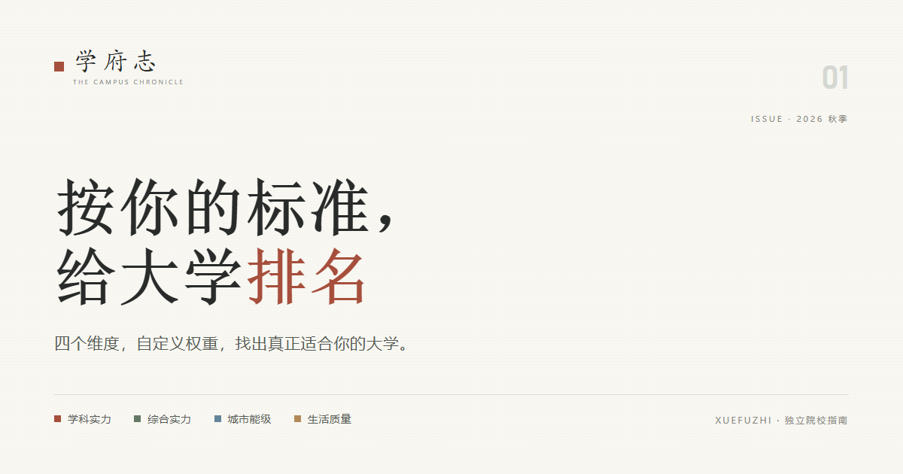

# 学府志 · The Campus Chronicle

> 按你的标准，给大学排名。

学府志是一个**独立院校指南**：不发布“官方排名”，而是把学科、综合、城市、生活四类数据整理成同一把 0–100 的尺子，把权重交给使用者——你更在意哪一面，名次就往哪一面走。



---


## 这是什么

大学排名通常是一张“唯一正确答案”的榜单。而我们认为择校标准因人而异：

- **四个维度**：学科实力 / 综合实力 / 城市能级 / 生活质量
- **四个独立权重**：0–100%，不必凑成 100%，每个维度下还可展开调子项
- **四维齐全才排名**：缺数据的学校进入「数据不足」区，不参与名次
- **不替你做决定**：只把数据与刻度摊开

---

## 功能

### 首页
- 档案卡视觉 + 「按你的标准，给大学排名」主张
- 「拖动权重，看前五名怎么变」实时演示（读取同一份数据）
- 四维标尺：真实分布的四分位点 + 当前档案位置
- 本期榜单（均衡权重 Top 10）
- 「换一张」随机翻一张四维齐全的档案卡

### 排名页
- 左侧权限面板：四个主维度 + 可展开子权重，吸顶跟随
- 五组预设：均衡 / 学科 / 综合 / 城市 / 生活
- 筛选：学科方向（门类 → 学科）/ 省份 / 层次 / 类型
- 实时重排、分页（每页 20 条）、页码跳转
- 「显示数据不足」开关（525 所排名 + 887 所数据不足）
- 权重、筛选、分页均实时生效

### 关于页（method.html）
- 四个维度算法、权重公式
- 数据来源与年份、覆盖统计、免责声明

---

## 数据

| 维度 | 数据来源 | 年份 |
|---|---|---|
| 学科实力 | 教育部第四轮学科评估（主）+ 软科中国最好学科排名（补） | 2017 / 2026 |
| 综合实力 | 软科中国大学排名（主）+ 校友会中国大学排名（补）+ QS 世界大学排名 | 2026 / 2026 / 2027 |
| 城市能级 | 中国城市统计年鉴（地级市 + 县级市） | 2025 |
| 生活质量 | CollegesChat 大学生生活质量问卷（12 项指标） | 自有整理 |

**覆盖**：1412 所本科院校；四维齐全 525 所（参与排名）；数据不足 887 所；城市能级覆盖 1382 所；生活质量覆盖 1314 所。

**口径**：所有维度换算为 0–100 百分位（50 = 参评院校中位）；缺失不填充；综合分 = Σ(维度分 × 权重) ÷ Σ权重。详细说明见关于页与数据包。

---

## 技术

- **纯静态**：单文件 HTML + 内联 CSS/JS，无构建、无 npm、无后端
- 数据通过 `<script src="data/schools.js">` 加载（`window.__SCHOOLS__`，约 860 KB）
- 字体使用系统字体栈（宋体 / 苹方 / 微软雅黑 / 楷体 / Bahnschrift），不依赖网络字体
- 兼容现代 Chrome / Edge / Safari

### 目录

```
.
├── index.html          # 首页
├── ranking.html        # 排名页
├── method.html         # 关于页
├── data/
│   ├── schools.js      # 前端数据包（1412 所）
│   └── schools.json    # 同内容 JSON
├── favicon.svg
├── og.png              # 分享图 1200×630
└── README.md
```

---


## 已知限制

- 学科评估为 2017 年第四轮，时效偏旧；新校用软科最好学科补
- 校友会补入 394 所，个别学校（社科院大学、西湖大学）综合分偏高，属榜单口径差异
- 30 所学校的城市未匹配（自治州/县级市为主），用同省中位数估算
- 关于页覆盖数字为静态文案，重建数据后需同步
- 尚未接入投档位次、就业质量、保研率等志愿场景数据
- 排名仅供择校参考，不构成录取预测或志愿填报建议

---

## 致谢

- 教育部学位与研究生教育发展中心：第四轮学科评估
- 软科：中国大学排名 / 中国最好学科排名
- QS：世界大学排名
- 校友会：中国大学排名
- 国家统计局：中国城市统计年鉴
- [CollegesChat](https://github.com/CollegesChat/university-information)：大学生生活质量问卷

---

## 版权

© 2026 学府志 The Campus Chronicle

页面设计与代码版权归项目所有者；各榜单与统计数据版权归原始发布方，使用请遵循原始来源的授权与引用要求。
